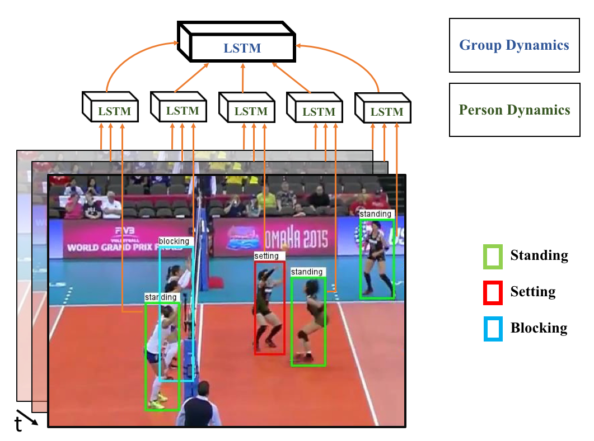

<div align="center">

# A Hierarchical Deep Temporal Model for Group Activity Recognition

[](https://arxiv.org/abs/1607.02643)


> **A 2-stage deep temporal model for recognizing group activities based on individual person dynamics.**

</div>

<div align="center">
   
</div>

## 📌 Overview

This repository contains the implementation of the experiments described in the paper [**"A Hierarchical Deep Temporal Model for Group Activity Recognition"**](https://arxiv.org/pdf/1607.02643) by Mostafa S. Ibrahim et al. (CVPR 2016).

The project tackles the complex task of group activity recognition by recognizing that the dynamics of an entire activity can be inferred from the actions of the individuals involved. It uses a two-stage hierarchical Long Short-Term Memory (LSTM) architecture:
1. **Person-level LSTM:** Captures the action dynamics of individual people within a sequence.
2. **Group-level LSTM:** Aggregates this person-level information to understand and classify the scene-level (group) activity.

## 🗂️ Project Structure

The project is structured into several modular components to separate data extraction, modeling, and evaluation logic.

```
group_activity_recognition/
├── data_utils/           # Data parsing, loading, and feature extraction (e.g., data_loader.py)
├── modeling/             # Implementations of different baselines (e.g., baseline1, baseline3, ..., baseline8)
├── evaluation/           # Validation and testing utilities
└── generic_utils/        # Shared helper functions
```

> **Note:** The `evaluation`, `generic_utils`, and `data_utils` directories (with the explicit exception of `data_loader.py`) are strictly **utility modules**. They contain shared code and functions meant to be imported and consumed by the main training and inference scripts. They are not intended to be executed directly.

## 💾 Dataset

This project uses the **Volleyball Dataset**, introduced by Mostafa S. Ibrahim et al. in the original paper. 

* **Description:** The dataset consists of 55 volleyball game videos with 4,830 labeled frames.
    * Every video is divided into a number of short clips. Every clip directory contains exactly 41 frames.
* **Annotations:** Each frame is annotated with:
  * The bounding box and individual action of each player (e.g., *waiting, setting, digging, spiking*).
  * The overall group activity label (e.g., *right set, left spike, right win point*).
* **Download:** You can download the raw dataset from the [official project page](https://drive.google.com/drive/folders/1rmsrG1mgkwxOKhsr-QYoi9Ss92wQmCOS).  
For more details about the data visit the authors' original [GitHub repository](https://github.com/mostafa-saad/deep-activity-rec?tab=readme-ov-file).

## ➡️ Usage

Follow these steps carefully to set up the data and start training the baselines.

### 0. Installation 📦

Clone the repository and install the project requirements:

```bash
git clone https://github.com/AhmeDHasan-110/group_activity_recognition.git
cd group_activity_recognition
pip install -r requirements.txt
```
- Tested with Python 3.12.3

> **Note:** PyTorch and torchvision are included in the requirements file. However, standard pip installations might not download the correct version for your specific CUDA drivers. It is strongly recommended to install PyTorch manually mapped to your hardware via the [official PyTorch instructions](https://pytorch.org/get-started/locally/) before installing the rest of the `requirements.txt`.

### 1. Dataset Configuration

Before executing any script, you must point the project to your local copy of the dataset.
1. Navigate to the `data_utils` folder and open `data_config.yml`.
2. Locate the `root` parameter.
3. Update the `root` path to match the absolute directory of your locally downloaded dataset.

### 2. Data Preparation

**Crucial Step:** Before running *any* baseline training scripts, you must pre-process the raw data. 

Run the data loader script to read the raw data, process it, and generate the prepared data pickle (`.pkl`) files. The training scripts rely entirely on these generated files to function.

```bash
python data_utils/data_loader.py
```

### 3. Training Baseline Models

After the `.pkl` files are created in your project, you can begin training. To avoid import errors, **you must run the training scripts from the project root directory**.  
You can find the YAML config files for each baseline inside the baseline's directory (`config.yml`).  
Feel free to modify the parameters, e.g., `batch_size` and `lr`, to try different configurations.   

```bash
# Example: Training Baseline 8 from the project root
python -m modeling.baseline8.train
```

## 📈 Results and Performance

To evaluate their model (Baseline 8), the authors ran ablation studies using several baselines.  
The table below presents a comparison between the accuracy of my implementation and the results reported in the paper for each baseline in this repository.

| Baseline | My Accuracy (%) | Paper Accuracy (%)|
|:---:|:---:|:---:|
| **Baseline 1** | 83.05 | 66.7 |
| **Baseline 3** | 74.12 | 68.1 |
| **Baseline 4** | 83.1 | 63.1 |
| **Baseline 5** | 73.15 | 67.6 |
| **Baseline 7** | 81.45 | 80.2 |
| **Baseline 8** | 90.88 | 81.9 |

> **Note:** `baseline 2` and `baseline 6` were skipped

My PyTorch implementation shows remarkable improvement in accuracy, achieving 91% compared to the original paper's 81.9%.  
The table also shows that baseline 8 significantly outperforms
the baseline models.  
This means that paying attention to fine-grained temporal dynamics(the player level LSTM) before modeling the higher level temporal features gave a huge advantage.

Other important details such as confusion matrix and training curves reside in the `results` directory for each baseline.

## 🔎 Why the higher accuracy?
My implementation achieves ~91% accuracy, significantly surpassing the 81.9% reported in the original 2016 paper. This performance boost is attributed to:
* **Backbone Upgrade:** Replaced the original AlexNet with a pre-trained **ResNet50**, which provides much more robust spatial feature extraction.
* **Modern Optimization:** Utilized **AdamW**, a modern optimizer that was not available during the paper's original development (2016). This, combined with better weight decay handling, leads to superior convergence.
* **Framework:** Implemented in **PyTorch**, leveraging modern deep learning libraries for more efficient training pipelines.

## 📊 Dynamic Quantization Benchmark (Baseline 8)

In addition to the standard evaluation on the test set, Baseline 8 includes custom support for applying **Dynamic Quantization** to the model to optimize inference performance. *(Note: This quantization exploration is an extension and is not part of the original paper).*

The goal of learning and applying quantization was to see its effect. So, a simple benchmark comparing the unquantized model against the dynamically quantized model is presented below:

<div align="center">

| Metric | <span style="color: #6C8EBF">Unquantized</span> | <span style="color: #82B366">Quantized</span> | <span style="color: #D6B656">Delta</span> |
|:---|---:|---:|---:|
| **Stage 1 Latency (ms)** | `14312.40` | `14245.68` | <span style="color: #82B366">-0.47%</span> |
| **Stage 2 Latency (ms)** | `138.02` | `26.98` | <span style="color: #82B366">-80.45%</span> |
| **Total Latency (ms)** | `14450.42` | `14272.66` | <span style="color: #82B366">-1.23%</span> |
| **Stage 1 Size (MB)** | `205.07` | `122.10` | <span style="color: #82B366">-40.46%</span> |
| **Stage 2 Size (MB)** | `1896.41` | `474.34` | <span style="color: #82B366">-74.99%</span> |
| **Total Size (MB)** | `2101.48` | `596.44` | <span style="color: #82B366">-71.62%</span> |
| **Test Accuracy (%)** | `90.87` | `90.27` | <span style="color: #D6B656">-0.60 pp</span> |

</div>

The results show that the largest improvement, especially in latency, occurs in the second stage, with a speedup of 80%. This is because the first stage is bottlenecked by its ResNet50 backbone, while dynamic PTQ mainly optimizes the linear and LSTM layers dominating the second stage. Notably, these gains were achieved with only a 0.6 pp drop in accuracy, showing the model remains robust after compression.

<br>

## 📝 Acknowledgments

### Citation
If you find this implementation helpful, please cite the original paper:

```bibtex
@inproceedings{ibrahim2016hierarchical,
  title={Hierarchical Deep Temporal Models for Group Activity Recognition},
  author={Ibrahim, Mostafa S. and Muralidharan, Srikanth and Deng, Zhiwei and Vahdat, Arash and Mori, Greg},
  booktitle={Proceedings of the IEEE Conference on Computer Vision and Pattern Recognition (CVPR)},
  pages={1971--1980},
  year={2016},
  publisher={IEEE}
}
```
